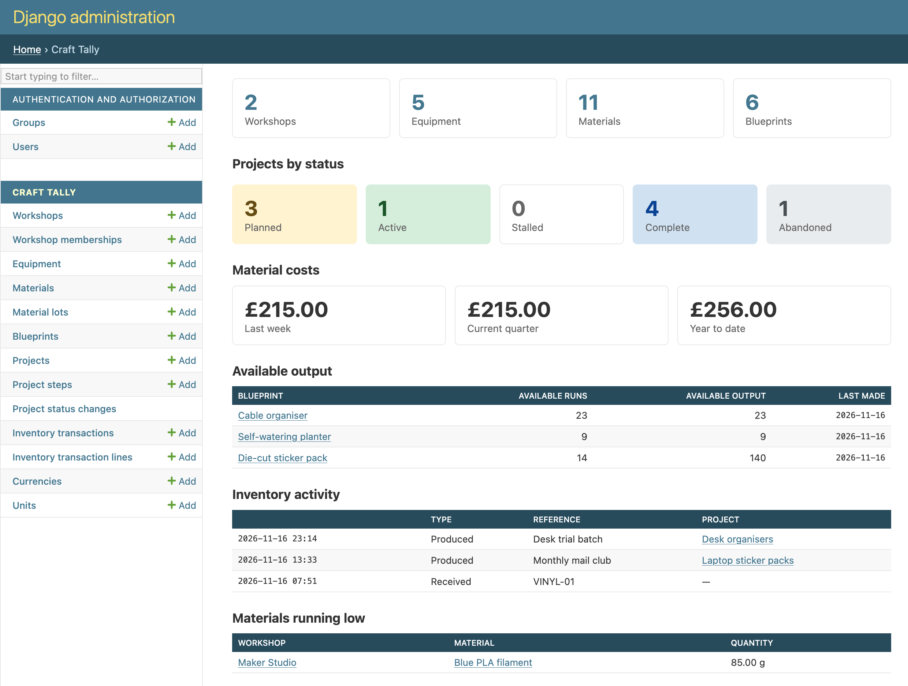

# dj-craft-tally

<!-- markdownlint-disable MD013 line-length -->

[](https://docs.djangoproject.com/en/stable/)

[](https://github.com/j178/prek)
[](https://github.com/pytest-dev/pytest)
[](https://github.com/wntrblm/nox)
[](https://coverage.readthedocs.io/)
[](https://github.com/albertomh/dj-craft-tally/actions/workflows/ci.yaml)
[](https://pypi.org/project/dj-craft-tally/)
<!-- markdownlint-enable MD013 line-length -->

`dj-craft-tally` is a Django app to help makers track projects and inventory across workshops.

> [!IMPORTANT]
> The project is in early development and uses 0.x versions.  
> Models, APIs, and workflows may change between releases.

<!-- markdownlint-disable MD033 no-inline-html -->
<div align="center">
  <!-- markdownlint-disable MD013 line-length -->
      
      <p align="center"></p>
  <!-- markdownlint-enable MD013 line-length -->
</div>
<!-- markdownlint-enable MD033 no-inline-html -->

## Prerequisites

- A Django webapp using Django >= 5.2

## Install

1. Add as a dependency:

    ```sh
    uv add dj-craft-tally
    ```

1. In `settings.py`, add to `INSTALLED_APPS` after any first-party apps and before
`django.contrib` packages.

    ```python
    INSTALLED_APPS = [
        ...,
        "dj_craft_tally",
        "dj_craft_tally.admin_apps.CustomAdminConfig",
        ...,
    ]
    ```

1. Apply the migrations from your Django project's directory:

    ```sh
    python manage.py migrate
    ```

    The initial migration creates a set of common units. The custom admin config
    orders `dj-craft-tally` models by their usual workflow. It replaces, rather
    than accompanies, `django.contrib.admin` in `INSTALLED_APPS`. Enable Django
    admin in your host project and use a staff account to manage the app's records.

    Units identify their conversion reference with `base_unit`: each seeded base
    unit points to itself and has a scale of 1, while other units point to that
    base and use `scale_to_base` as their multiplier. A null base means the
    reference is unspecified. Units sharing a base must have the same dimension;
    call `full_clean()` when creating or changing units to validate this relation.

## Features

`dj-craft-tally` extends the Django admin to help you:

- Organise materials, equipment, and projects by workshop.
- Describe blueprint outputs & material requirements.
- Record material lots and inventory movements.
- Record an optional purchase amount and currency for each material delivery.
- i18n ready, with translation packs for Spanish & French.

## How it fits together

The models describe **the work you're doing**, **a reusable description of how to
do it**, and **records of what happened**:

- A **Project** is the work you're doing, such as 3D-printing a dice tower. Its current
  status shows how it's going; **project status changes** keep a history of that
  progress.
- A **Process** is a reusable description of how to work, made up of ordered
  **process steps**. A resin-printing process might say Print, then Wash, then Cure.
- An **Activity** records work, including details such as when it happened, the
  outcome and materials used. It can be linked to a project or a process step.
  Activities can also stand alone: cleaning a vat or changing the FEP doesn't
  need a project.

A process describes a way to work; activities record the work itself. You can
reuse the same process across projects and record activities without following one.

See the [documentation](https://albertomh.github.io/dj-craft-tally/) for an admin
walkthrough.

## Develop

### Development prerequisites

The following tools must be available locally to develop `dj-craft-tally`:

- [uv](https://docs.astral.sh/uv/)
- [prek](https://prek.j178.dev/)

### Run tests

The project aims for 100% test coverage. `nox` is used to run the test suite against
all supported Python/Django pairings (see [`noxfile.py`](./noxfile.py#L5)).

```sh
# run latest supported Python/Django pairing only
# (eg. Python 3.15 / Django 6.1)
uvx nox

# run all test sessions (ie. all supported Python/Django pairings)
uvx nox -s test
```

### Run the local demo project

There is a demo Django project for exploring the app in the admin while
developing it. From the repo root, run:

```sh
uv sync
uv run python demo/manage.py migrate
uv run python demo/manage.py seed_demo
uv run python demo/manage.py runserver
```

Sign in at <http://127.0.0.1:8000/admin/> with username `demo` and password `demo`.
To reset the demo, delete `demo/db.sqlite3`, then rerun the migrations and seed command.

### Use the development version in projects

Build the package as a binary distribution (wheel) and install it in a Django project:

```sh
# from dj-craft-tally's root directory
uv build

# in the target Django webapp project
uv add ~/Projects/dj-craft-tally/dist/dj_craft_tally-M.m.p-py3-none-any.whl
```

### Build documentation

Documentation is hosted at <https://albertomh.github.io/dj-craft-tally/>.
It is built with [Zensical](https://zensical.org/).

```sh
# preview docs site locally on :9000
uv sync --group docs
uv run zensical serve -a localhost:9000
```

Pushes to `main` that change documentation deploy to GitHub Pages.

### Develop translations

The package uses Django gettext catalogs under
`src/dj_craft_tally/locale/<language>_<territory>/LC_MESSAGES/`. Mark user-facing
Python and template strings for translation, then regenerate the catalogs from
the package directory:

```sh
cd src/dj_craft_tally && \
uv run django-admin makemessages -l es_ES -l fr_FR
```

Review and update the generated `.po` files, then compile them to `.mo` files.
Commit both formats so wheels and source distributions include translations:

```sh
cd src/dj_craft_tally && \
msgfmt -o locale/es_ES/LC_MESSAGES/django.mo \
  locale/es_ES/LC_MESSAGES/django.po
msgfmt -o locale/fr_FR/LC_MESSAGES/django.mo \
  locale/fr_FR/LC_MESSAGES/django.po
```

The demo enables `es-es` and `fr-fr` and exposes Django's standard language
switching endpoint at `/i18n/`. To see translations in action: run the demo as above,
switch language in the session, and visit `/admin/crafttally/`.
